# ☁️ Awesome-Cloud-Data-Backup-Recovery 🛡️

  

### ⚡ Curated Directory of Enterprise SaaS Solutions & Open-Source Engines for Cloud Data Resilience, BaaS & DRaaS 🚀

  
  
  
  
  

  <b>Comprehensive ecosystem guide covering Backup-as-a-Service (BaaS), Disaster Recovery as a Service (DRaaS), Ransomware Cyber Cleanrooms, and Kubernetes Snapshot Storage.</b>

---

## 📑 Table of Contents

- [📊 Sector Overview & Market Dynamics](#-sector-overview--market-dynamics)
- [🏢 SaaS & Hosted Platforms](#-saashosted-platforms)
- [💻 Open-Source GitHub Projects](#-open-source-github-projects)
- [🏗️ Architectural Frameworks for Custom BaaS/DRaaS](#️-architectural-frameworks-for-custom-baasdraas)
- [🤝 How to Contribute](#-how-to-contribute)
- [💖 Support & Sponsorship](#-support)
- [📈 Star History](#--star-history)
- [⚠️ Disclaimer](#-disclaimer)

---

## 📊 Sector Overview & Market Dynamics

The global Cloud Backup and Disaster Recovery (BDR / DRaaS) market is valued between **$34B–$37B in 2025–2026** and projected to surpass **$54B+ by 2030**, fueled by aggressive double-digit DRaaS growth (20%+ CAGR) driven by strict cyber-insurance mandates, ransomware protection, and hybrid multi-cloud adoption. The market exhibits **moderate fragmentation**: established cyber-resilience leaders (such as Rubrik, Veeam, Commvault, and Cohesity) dominate enterprise tier deals and continue strategic consolidation, while specialized MSP backup solutions, cloud-native providers, and vibrant open-source frameworks prevent winner-take-all capture and power modern self-hosted architectures.

---

## 🏢 SaaS/Hosted Platforms

| Product | Valuation / Revenue Scale | Description | Starting Pricing | Free Tier / Trial Limits |
|---|---|---|---|---|
| **[Rubrik Cloud Data Management](https://www.rubrik.com/)** | ~$25.0B Market Cap (NYSE: RBRK, ~$1.8B+ ARR) | Cloud data management and cyber-recovery platform with immutable backups, ransomware anomaly detection, and automated recovery orchestration. | Foundation/SaaS tiers start at ~$50,000–$60,000/year for mid-market; Azure Marketplace enterprise listings start at $90,000/month. | 30-day proof-of-concept / evaluation via sales (SaaS M365 evaluations capped at 500 users and 10 TB). |
| **[Veeam Cloud Connect](https://www.veeam.com/)** | ~$15.0B Valuation (Private equity, ~$2.0B+ ARR) | Multi-tenant cloud backup and DRaaS platform for service providers and hybrid enterprises to deliver off-site cloud replication. | SaaS/M365 protection from $2.63/user/month; VCSP rental points apply per VM workload; standalone self-hosted server licenses from $420/year. | 30-day free trial (VCSP partner trials typically include 500 GB to 3 TB cloud storage allocation). |
| **[Zoho Backup](https://www.zoho.com/)** | ~$12.5B Valuation (Bootstrapped, ~$1.5B Revenue) | Native automated cloud data backup and export services for Zoho CRM, Bigin, and Zoho cloud applications. | Free edition: $10 per on-demand backup export; Standard/Professional/Enterprise tiers: 2 free backups/month, then $10/additional backup. | Free Forever Tier includes 1 GB storage (and 5 GB on Zoho Mail), but requires $10/export for full database backups; paid CRM plans get 2 free monthly backups. |
| **[Cohesity DataProtect](https://www.cohesity.com/)** | ~$7.5B Valuation (Combined with Veritas, ~$1.5B ARR) | AI-powered data security and cyber-resilience platform providing immutable snapshots, cleanroom recovery, and DataProtect as a Service (DPaaS). | DPaaS starts at ~$200–$500 per TB annually (based on retention policies, replication scope, and enterprise SLA). | 30-day free trial for Cohesity Cloud Services / BaaS via sales coordination. |
| **[Commvault Complete Backup & Recovery](https://www.commvault.com/)** | ~$6.8B Market Cap (NASDAQ: CVLT, ~$1.18B Revenue) | Enterprise cyber-resilience platform with immutable cloud backups, air-gapped copies, and automated cleanroom recovery environments. | Commvault Cloud SaaS starting from ~$120/endpoint user/year, ~$1,885/physical server/year, and ~$2,729/VM instance/year. | 30-day free trial for Commvault Cloud SaaS workloads (Microsoft 365, endpoints, and cloud data). |
| **[Datto SIRIS](https://www.datto.com/)** | ~$6.2B Valuation (Acquired by Kaseya for $6.2B) | Business continuity and disaster recovery (BCDR) appliance and cloud solution offering local virtualization, cloud failover, and screenshot verification. | SIRIS appliances start from ~$995–$1,095 (based on hardware model, protected servers, and cloud retention contract). | 14-day free trial for Datto RMM / cloud management platform via partner program. |
| **[Acronis Cyber Protect Cloud](https://www.acronis.com/)** | ~$3.5B Valuation (Acquired by EQT, ~$400M+ Revenue) | Integrated cyber protection platform combining backup, disaster recovery, vulnerability assessment, and AI-based anti-ransomware protection. | Workload-based starting at ~$40/server/month or ~$15/VM/month; or per-GB storage starting from a minimum monthly commitment of $250. | 30-day free trial including 1 TB Acronis Cloud Storage testing allocation. |
| **[Druva](https://www.druva.com/)** | ~$2.0B Valuation (Series H, ~$200M+ ARR) | 100% SaaS-native data protection offering global deduplication, autonomous cloud disaster recovery, and ransomware quarantine. | SaaS/M365 starting from ~$4.00–$8.00/user/month; enterprise infrastructure workloads from ~$210/TB/month (post-deduplication). | 30-day free trial with full SaaS feature access (no credit card required). |
| **[Carbonite](https://www.carbonite.com/)** | ~$1.45B Valuation (Acquired by OpenText for $1.45B) | Automated endpoint and server cloud backup with granular restoration, compliance archiving, and centralized web management. | Carbonite Safe personal from $4.92/month ($58.99/year); Business Backup (Power Plan: 1 server + 25 computers, 500 GB) from $50/month ($599.99/year). | 15-day free trial for Carbonite Safe personal; 30-day free trial for Carbonite Business Backup. |
| **[Backblaze B2](https://www.backblaze.com/)** | ~$500M Market Cap (NASDAQ: BLZE, ~$130M+ Revenue) | S3-compatible cloud object storage built for backup targets, system images, and long-term disaster recovery archives. | $6.95/TB/month for cloud storage; egress beyond 3x average stored data billed at $0.01/GB. | Free Forever Plan includes first 10 GB cloud storage free with free egress up to 3x average stored volume. |

---

## 💻 Open-Source GitHub Projects

Curated list of the top open-source backup systems, deduplicated snapshot tools, disaster recovery frameworks, and cloud replication engines, ranked by community adoption (**GitHub stargazers** in descending order):

| Project | GitHub Stars | Primary Language / Domain | Description |
|---|---|---|---|
| **[Rclone](https://github.com/rclone/rclone)** |  | Go • Multi-Cloud Sync | The "rsync for cloud storage" supporting over 70 cloud object providers (S3, GCS, Azure Blob, B2, SFTP). Provides synchronization, encryption, caching, and mounting for backup pipelines. |
| **[Restic](https://github.com/restic/restic)** |  | Go • Deduplicated Snapshots | Fast, secure, and authenticated backup program using content-defined chunking (CDC) deduplication and client-side encryption. Works natively with local, SFTP, and object storage. |
| **[Duplicati](https://github.com/duplicati/duplicati)** |  | C# / .NET • Web UI Backup | Free backup client that securely stores encrypted, incremental, compressed backups on cloud storage providers and remote file servers with a built-in web management interface. |
| **[Kopia](https://github.com/kopia/kopia)** |  | Go • Encrypted Snapshots | High-performance snapshot backup tool featuring end-to-end encryption, deduplication, compression, desktop GUI, server mode, and direct object storage connectivity. |
| **[BorgBackup](https://github.com/borgbackup/borg)** |  | Python / C • Deduplicating Engine | Mature, battle-tested deduplicating backup engine with authenticated encryption and ZSTD compression. The gold standard for self-hosted Linux server and workstation backups. |
| **[Velero](https://github.com/vmware-tanzu/velero)** |  | Go • Kubernetes DR | Cloud-native disaster recovery and migration tool for Kubernetes clusters. Safely backs up, restores, and replicates cluster state and persistent volumes across cloud environments. |
| **[bup](https://github.com/bup/bup)** |  | Python / C • Git-Pack Storage | Highly efficient backup system based on the Git packfile format, capable of deduplicating massive disk images and virtual machines with rolling checksum chunking. |
| **[pgBackRest](https://github.com/pgbackrest/pgbackrest)** |  | C • PostgreSQL Backup & DR | High-throughput, enterprise-ready backup and restore solution for PostgreSQL databases featuring parallel compression, delta restores, and direct S3/Azure/GCS cloud streaming. |
| **[WAL-G](https://github.com/wal-g/wal-g)** |  | Go • Database Cloud Archiving | Archival and disaster recovery engine for PostgreSQL, MySQL, MariaDB, MongoDB, and FoundationDB with continuous WAL streaming, multi-core compression, and cloud push. |
| **[Rustic](https://github.com/rustic-rs/rustic)** |  | Rust • Restic-Compatible | Blazing-fast, memory-safe backup client and library written in Rust. Fully compatible with the Restic repository format with native multi-threading and synthetic snapshot handling. |
| **[Barman](https://github.com/EnterpriseDB/barman)** |  | Python • PostgreSQL DR Manager | Administrative backup and recovery manager for remote PostgreSQL clusters, supporting continuous archiving, WAL streaming, zero data loss (RPO=0), and remote restore. |
| **[Vorta](https://github.com/borgbase/vorta)** |  | Python / Qt • Desktop GUI | Elegant desktop GUI client for BorgBackup on macOS and Linux. Integrates scheduled profile backups, repo initialization, SSH key management, and snapshot browsing. |
| **[borgmatic](https://github.com/borgmatic-collective/borgmatic)** |  | Python • Declarative Config | Declarative, configuration-driven wrapper for BorgBackup with integrated pre/post hooks for dumping databases (PostgreSQL, MySQL, SQLite, MongoDB) and healthchecks. |
| **[Restic REST Server](https://github.com/restic/rest-server)** |  | Go • Secure Backup Target | High-performance, secure HTTP server implementing Restic's REST backend API with append-only mode to safeguard repositories against ransomware tampering. |
| **[Bareos](https://github.com/bareos/bareos)** |  | C / C++ • Cross-Network DR | Open-source fork of Bacula offering reliable, enterprise-wide network backup, archiving, and disaster recovery across heterogeneous Linux, Unix, Windows, and macOS fleets. |
| **[ReaR (Relax-and-Recover)](https://github.com/rear/rear)** |  | Shell • Bare-Metal DR | Linux disaster recovery framework producing bootable rescue media and automated system state restoration across local disks, SAN, NAS, and network backup solutions. |

---

## 🏗️ Architectural Frameworks for Custom BaaS/DRaaS

Organizations building self-hosted, vendor-neutral backup pipelines can combine these components into resilient production workflows:

- **Object Storage & Cloud Targets**: Use **Rclone** or **Backblaze B2 / MinIO** for federated, multi-cloud replication.
- **System & File Backups**: Deploy **Restic** or **BorgBackup** for client-side encrypted, block-deduplicated archives.
- **Database High Availability & PITR**: Leverage **pgBackRest** or **WAL-G** for continuous WAL shipping and point-in-time recovery to S3 buckets.
- **Container Infrastructure**: Run **Velero** with automated CSI volume snapshotters to protect Kubernetes workloads across clusters and cloud providers.
- **Ransomware Defense**: Enable **Restic REST Server** with append-only flags or S3 Object Lock (WORM) storage policies to prevent malicious snapshot deletion.

---

## 🤝 How to Contribute

Contributions are welcome to keep this directory comprehensive and up-to-date!

1. 🍴 Fork this repository.
2. 🌿 Create a feature branch (`git checkout -b feature/add-new-backup-tool`).
3. ✍️ Add the SaaS or Open-Source project entry following the existing table formatting. Include factual starting prices, free tier limits, and links to official documentation.
4. 🚀 Commit your changes (`git commit -m 'Add New Backup Tool'`).
5. 📬 Push to your branch and open a Pull Request.

---

## 💖 Support

If you find this curated ecosystem directory helpful for architecting your backup strategies, consider supporting the project:

- ⭐ **Star this repository** to improve visibility for the cloud and SRE community!
- 🍴 **Fork and share** with colleagues and DevOps teams.
- ☕ **Buy me a coffee / Sponsor the project**: Support ongoing maintenance via the [GitHub Sponsors Dashboard](https://github.com/sponsors/ishandutta2007).

---

##  Star Hiotory

---

## ⚠️ Disclaimer

- This is an independent, community-curated collection intended for educational and architectural reference—not an official endorsement.
- Backup and disaster recovery solutions protect mission-critical business data. Always enforce encryption in transit and at rest, configure least-privilege credentials, and regularly perform end-to-end restore drills to validate your Recovery Time Objective (RTO) and Recovery Point Objective (RPO).

---

  Maintained by <a href="https://github.com/ishandutta2007">Ishan Dutta</a> • Built for SREs, Platform Engineers, and Cloud Resilience Architects.

